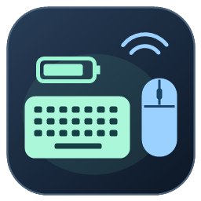
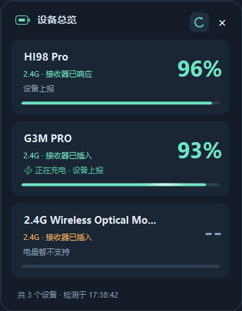

# 无线设备电量面板



Windows 10/11 64 位键盘、鼠标与蓝牙设备电量工具。原生 C# / WinForms，单个 EXE，无需安装 Python，也无需安装本项目之外的第三方运行库。

当前版本：**2.12.0**。



## 功能

- 总览页同时显示设备电量、连接方式和数据来源，设备多时可滚动。
- 一个托盘图标同时显示两台设备的电量；小尺寸点阵数字、设备名称悬停提示。
- 启动自动扫描，约每 10 秒检查设备；常规硬件电量采样约 30 秒，已适配设备充电时约 10 秒。
- 检测离线持续一分钟后从展示中移除，重连后自动恢复。
- 已识别的充电状态显示闪电呼吸和进度条流光；窗口隐藏时暂停动画。
- 小刷新按钮、超时恢复、窗口缩放、透明度、位置锁定、可选开机启动。
- 设备 USB 路径区分、异常容器编号过滤，减少多接口重复和不同设备误合并。

## 设备支持与验证范围

| 设备 | 当前能力 | 验证情况 |
| --- | --- | --- |
| LEOBOG HI98 Pro / `3554:FA09` | 2.4G 电量、插线状态提示 | 本机实测 |
| G3M PRO / `320F:706E`、`320F:706B` | 电量、充电及充满状态；有线查询合并到原卡片 | 本机实测 |
| `1D57:130F` 无线接收器 | 自动发现与存在状态，电量显示 `--` | 本机实测发现；电量协议未适配 |
| 蓝牙设备 | Windows 电量与充电属性；同一容器子节点补充读取 | 逻辑模拟测试；缺少真实蓝牙电量、充电硬件验证 |
| 其他 2.4G 接收器 | 部分名称/编号识别 | 需要对应型号的电量协议 |

**不是所有无线设备都能读取电量。** “接收器已插入”仅确认 USB 接收器存在，不等于鼠标、键盘或耳机一定在线。未知型号无法确认外设断开时，只能在接收器拔出后计时移除。设备休眠无响应也可能暂时被移除，唤醒后恢复。

电量均为设备或 Windows 上报，未进行放电曲线校准。HI98 Pro 在本机测试中插线后会立即上报 100%，不能据此判断已经充满；插线标记依据本机插拔前后报文接入，未得到厂商协议确认。G3M PRO 充电状态采用该型号的协议规则。动画仅展示已识别的状态，不模拟剩余电量。

Windows 属性可能缓存，蓝牙属性未提供、断开、无效或冲突时不填入猜测值。不同设备的数据不按相似名称混用。

## 使用

下载构建产物中的 `WirelessBatteryPanel.exe` 并双击。可改名后放到桌面；图标内嵌，无需附带 ICO 或源文件。

- 右上角小按钮：立即刷新全部设备。
- 右上角关闭：收起到托盘；双击托盘重新打开。
- 右键面板或托盘：显示设置、开机启动与退出。
- 托盘被隐藏时，可从 Windows 通知区域展开并拖出。
- 设置存储于 `%LOCALAPPDATA%\WirelessBatteryPanel\settings.xml`，不需要把设置文件放在桌面。

窗口只展示无线设备；已适配鼠标的 USB 有线接口用于补充充电查询，不单独生成有线卡片。多个同型号设备无法可靠关联时，不猜测有线与无线的对应关系。

## 本地构建

在 Windows 10/11 64 位系统运行：

```powershell
.\scripts\build.ps1 -Test
```

使用 Windows 自带 .NET Framework C# 编译器与系统 WinRT 元数据。产物为 `dist/WirelessBatteryPanel.exe`。脚本不会安装驱动或启动常驻程序。自检验证解析、充电映射、接收器去重与离线生命周期，不替代真实硬件测试。

可选的本机检查命令：

```powershell
.\dist\WirelessBatteryPanel.exe --inventory-probe inventory.txt
.\dist\WirelessBatteryPanel.exe --ui-test ui-check
```

GUI 测试会临时创建窗口，并在 EXE 同目录保存测试设置和图片；日常使用不需要运行。诊断文件可能含设备标识，提交问题前请自行删去个人信息。

## 项目结构

```text
src/Hi98Battery.cs        主程序及内置自检
assets/app.ico           内嵌 Windows 软件图标
scripts/build.ps1        本地及 CI 构建
scripts/CreateAppIcon.cs  图标绘制源文件
docs/screenshot.png      总览示例
docs/protocols.md         协议与充电状态边界
```

## 参考

- G3M PRO 协议参考：[G3M-PRO-Controller](https://github.com/BlueEve04/G3M-PRO-Controller)。
- 点阵数字和蓝牙子节点补查借鉴用户提供的 `2.4G-battery-viewer-main` 项目思路，运行时不依赖该 Python 项目。
- Windows 属性：[设备信息属性](https://learn.microsoft.com/en-us/windows/apps/develop/devices-sensors/device-information-properties)、[ChargingState](https://learn.microsoft.com/en-us/windows/win32/properties/props-system-devices-chargingstate)。
